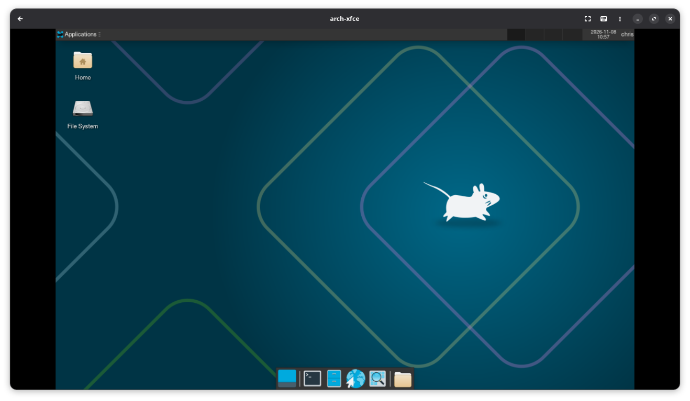
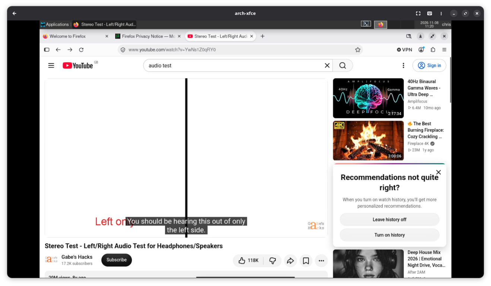

# arch-xfce

VM-first Arch Linux XFCE laptop build, adapted from
[druidhtpc](https://github.com/ccdale/druidhtpc).
The host builder boots an Arch ISO; installation is interactive inside the guest.

## Initial XFCE desktop

The default XFCE home screen after first login: ripe and ready for customisation.



## Layout and security

Default disk: 128 GiB, GPT/UEFI only.

| Storage | Size | Purpose |
| --- | --- | --- |
| EFI system partition | 2 GiB | Unencrypted systemd-boot and separate boot assets for each slot |
| LUKS2 container | Remaining disk | One passphrase unlocks the LVM volume group `archxfce` |
| `root_a`, `root_b` | 32 GiB each | Independent ext4 root filesystems, including their own `/boot` |
| `home` | Remaining LVM space | Shared ext4 `/home`, encrypted with both roots |

No embedded passwords, autologin, passwordless sudo, or encryption keyfiles.
Root login is locked; `chris` has password-authenticated sudo.
Secure Boot and hibernation are **not configured**. Encryption protects data at
rest, not against modification of the unencrypted boot partition.
There is no disk swap; normal suspend is available, subject to hardware support.
Shared home is not rolled back: application migrations may affect older slots.
Keep independent backups; A/B slots are not backups or transactional snapshots.

XFCE, LightDM, Firefox, NetworkManager, PipeWire, Bluetooth, printing, and VM
integration are installed. Defaults: UK console/X keyboard, `en_GB.UTF-8`,
`Europe/London`. No HTPC/DVB applications or recording disk are copied.

## Host prerequisites

Install libvirt/QEMU with UEFI firmware, virtiofsd, virt-install, and virt-viewer.
On Arch, for example:

```bash
sudo pacman -S --needed libvirt qemu-desktop edk2-ovmf virtiofsd virt-install virt-viewer
```

Ensure `qemu:///session` is working and obtain a current, verified Arch x86_64 ISO.
The default ISO path is `$HOME/Downloads/archlinux-x86_64.iso`.
The work share gives the guest write access to this project's ignored `work/`,
not the source directory. A second writable virtiofs share exposes the pacman
cache, defaulting to `../druidhtpc/work/pacman-cache` relative to this project
(here `/home/chris/src/druidhtpc/work/pacman-cache`).
Override `PACMAN_CACHE_DIR` to use a different persistent host directory:

```bash
PACMAN_CACHE_DIR="$HOME/.cache/arch-pacman" ./build-arch-xfce.sh
```

The builder creates the cache directory if necessary and never erases it during
VM rebuilds. Once `/work` is mounted, the installer automatically mounts the
`pacman-cache` share at `/pacman-cache` and bind-mounts it into the target cache
before `pacstrap`. Matching package versions are reused; missing/newer versions
still download. The bind mount is removed before fstab generation and initial
slot cloning, so no host-cache dependency is installed on the laptop.
Missing or invalid VM cache shares cause an explicit error, not a local-cache
fallback. Without a mounted `/work` (bare-metal installation), the installer
explicitly uses a target-local cache.
This shares installation downloads only; normal installed-system slot updates
continue to use their local cache. Avoid concurrent cache cleanup while building.

```bash
./build-arch-xfce.sh
# Or:
ARCH_ISO=/absolute/path/to/archlinux.iso ./build-arch-xfce.sh
```

Override `VM_NAME`, `DISK_DIR`, `RAM_MB`, `VCPUS`, or `DISK_GB` through environment
variables. Existing VMs/disks are refused unless `--recreate` is supplied and the
VM name is typed to confirm erasure. Rebuilding loses all guest data.
Closing the viewer does not shut down the VM.

## Install inside the Arch ISO

Verify internet connectivity and the disk with `lsblk`. User-mode NAT is used
when the session has no default libvirt network.

```bash
loadkeys uk
mkdir -p /work
mount -t virtiofs work /work
/work/arch-xfce/arch-xfce-setup.sh
```

The installer defaults to `/dev/vda`, refuses mounted/in-use targets, and requires
typing the full disk path before partitioning. Cryptsetup requests and confirms
the LUKS passphrase; it requests it again to open the container. The account
password is entered separately. **Do not lose the encryption passphrase.**
Installation ends with both slots populated, ready for first boot.

For different defaults, prefix the guest command with environment assignments:

```bash
TARGET_DISK=/dev/nvme0n1 USERNAME=chris SYSTEM_HOSTNAME=arch-laptop \
  /work/arch-xfce/arch-xfce-setup.sh
```

Supported overrides also include `VG_NAME`, `SLOT_GB`, `TIMEZONE`, `LOCALE`,
and `KEYMAP`. For non-UK keyboards verify the generated X keyboard layout:
console keymap names are not always XKB layout names.
Do not rerun an installer after failure without inspecting its mounted filesystems
and open LUKS/LVM mappings; it is destructive, not a resume operation.

Power off the guest after installation:

```bash
poweroff
```

On the host, identify the CD-ROM target and eject the ISO from the persistent
definition, then start the installed VM:

```bash
virsh --connect qemu:///session domblklist arch-xfce
# Replace sda with the CD-ROM target shown above:
virsh --connect qemu:///session change-media arch-xfce sda --eject --config
virsh --connect qemu:///session start arch-xfce
virt-viewer --connect qemu:///session arch-xfce --attach
```

## Verify and update A/B slots

Unlock at boot, log in through LightDM, and check:

```bash
findmnt /
findmnt /home
findmnt /efi
lsblk -f
systemctl --failed
```

Example output from a Slot A installation (UUIDs are identifiers, not secrets,
and will differ on each fresh installation; available space and usage also vary).
The `/efi` options below are truncated as displayed in the captured terminal:

```text
[chris@arch-xfce ~]$ findmnt /
TARGET SOURCE                      FSTYPE OPTIONS
/      /dev/mapper/archxfce-root_a ext4   rw,relatime
[chris@arch-xfce ~]$ findmnt /home
TARGET SOURCE                    FSTYPE OPTIONS
/home  /dev/mapper/archxfce-home ext4   rw,relatime
[chris@arch-xfce ~]$ findmnt /efi
TARGET SOURCE FSTYPE OPTIONS
/efi   /dev/vda1
              vfat   rw,relatime,fmask=0022,dmask=0022,codepage=437,iocharset=as
[chris@arch-xfce ~]$ lsblk -f
NAME FSTYPE FSVER LABEL       UUID                                   FSAVAIL FSUSE% MOUNTPOINTS
sr0
vda
|-vda1
|    vfat   FAT32 EFI         17D3-F1B5                                 1.8G     8% /efi
`-vda2
  |  crypto 2                 6491d1f3-b35e-438d-b140-867ecf43916c
  `-archxfce_crypt
    |  LVM2_m LVM2              2OivcA-NgoV-sK81-ApMy-DaOe-wieo-27c5el
    |-archxfce-root_a
    |  ext4   1.0   Slot_A      975780fd-f790-4dee-9080-5593fdabeeec     26.6G    10% /
    |-archxfce-root_b
    |  ext4   1.0   Slot_B      9869ccf9-f8b6-4a58-9599-d4cbc6b069c2
    `-archxfce-home
       ext4   1.0   Shared_Home ac863df8-a0e8-4cd1-99a1-a38678bbc9a9     57.6G     0% /home
[chris@arch-xfce ~]$
```

Tree characters are rendered in ASCII above for readability in plain-text tools.

Boot **both** menu entries. Roots should switch between `root_a` and `root_b`;
home should stay on the same LV. Confirm desktop, network, audio, sudo, and a
file in home persist across the switch.

### Slot B and shared-home verification

Expected example session after rebooting into Slot B. Both slots use the same
home and EFI filesystems, and `systemctl --failed` should list no failed units.
The `/efi` options are truncated as displayed in the captured terminal:

```text
[chris@arch-xfce ~]$ findmnt /
TARGET SOURCE                      FSTYPE OPTIONS
/      /dev/mapper/archxfce-root_b ext4   rw,relatime
[chris@arch-xfce ~]$ findmnt /home
TARGET SOURCE                    FSTYPE OPTIONS
/home  /dev/mapper/archxfce-home ext4   rw,relatime
[chris@arch-xfce ~]$ findmnt /efi
TARGET SOURCE FSTYPE OPTIONS
/efi   /dev/vda1
              vfat   rw,relatime,fmask=0022,dmask=0022,codepage=437,iocharset=as
[chris@arch-xfce ~]$ systemctl --failed
  UNIT LOAD ACTIVE SUB
DESCRIPTION

0 loaded units listed.
[chris@arch-xfce ~]$ ls ~/
Desktop
[chris@arch-xfce ~]$ touch ~/test
[chris@arch-xfce ~]$ ls ~/
Desktop  test
[chris@arch-xfce ~]$
```

After rebooting back into Slot A, the root changes but the file created in
Slot B remains in shared home. Directory contents and timestamps will vary:

```text
[chris@arch-xfce ~]$ findmnt /
TARGET SOURCE                      FSTYPE OPTIONS
/      /dev/mapper/archxfce-root_a ext4   rw,relatime
[chris@arch-xfce ~]$ ls -l ~/
total 4
drwxr-xr-x 2 chris chris 4096 Nov  8 10:46 Desktop
-rw-r--r-- 1 chris chris    0 Nov  8 11:05 test
[chris@arch-xfce ~]$
```

This verifies that both root slots boot and user files persist across slot
switches. It does not yet verify an inactive-slot package upgrade.

### Updating the inactive slot

```bash
sudo arch-xfce-slot-update
```

This clones the active root to the inactive root, corrects its fstab UUID,
performs a full Arch upgrade there, regenerates initramfs, and publishes only
that slot's boot entry. Home and EFI are not mounted in the update chroot.
The inactive menu entry is removed before cloning and remains unavailable on
failure. The active slot's boot files and default boot selection are unchanged.
Select the updated slot manually to test; change the default with
`sudo bootctl --esp-path=/efi set-default arch-xfce-b.conf` (or `a`).
Do not update the active slot concurrently or use the inactive root elsewhere.

Prefer this updater over running `pacman -Syu` on the active root. If you do
change the active kernel, run `sudo arch-xfce-slot-update --publish-current`
before rebooting so its EFI assets match. `--clone-only` seeds the other slot
without upgrading and is used during installation.
Each publication writes a fresh generation under `/efi/arch-xfce/` and atomically
replaces that slot's entry before removing its obsolete boot assets. The other
slot's assets are never removed. A/B rollback means booting the other root, not
using an older kernel with an already-upgraded root.

### Example update run and subsequent Slot B boot

Captured update output from Slot A (the first-use sudo lecture is omitted):

```text
[chris@arch-xfce ~]$ sudo arch-xfce-slot-update
[sudo] password for chris:
Cloning slot A to B; shared /home is not copied.
Updating inactive slot B.
:: Synchronising package databases...
 core is up to date
 extra                   8.6 MiB  4.69 MiB/s 00:02 [######################] 100%
:: Starting full system upgrade...
 there is nothing to do
==> Building image from preset: /etc/mkinitcpio.d/linux.preset: 'default'
==> Using default configuration file: '/etc/mkinitcpio.conf'
  -> -k /boot/vmlinuz-linux -g /boot/initramfs-linux.img
==> Using drop-in configuration file: 'arch-xfce.conf'
==> Starting build: '7.2.14-arch1-1'
  -> Running build hook: [base]
  -> Running build hook: [systemd]
  -> Running build hook: [microcode]
  -> Running build hook: [modconf]
  -> Running build hook: [keyboard]
==> WARNING: Possibly missing firmware for module: 'xhci_pci_renesas'
  -> Running build hook: [sd-vconsole]
  -> Running build hook: [block]
==> WARNING: Possibly missing firmware for module: 'qed'
==> WARNING: Possibly missing firmware for module: 'bfa'
==> WARNING: Possibly missing firmware for module: 'qla1280'
==> WARNING: Possibly missing firmware for module: 'wd719x'
==> WARNING: Possibly missing firmware for module: 'aic94xx'
==> WARNING: Possibly missing firmware for module: 'qla2xxx'
  -> Running build hook: [sd-encrypt]
==> WARNING: Possibly missing firmware for module: 'qat_6xxx'
  -> Running build hook: [lvm2]
  -> Running build hook: [filesystems]
  -> Running build hook: [fsck]
==> Generating module dependencies
==> Creating zstd-compressed initcpio image: '/boot/initramfs-linux.img'
  -> Early uncompressed CPIO image generation successful
==> Initcpio image generation successful
Slot B is ready. Reboot and select it; the default remains unchanged.
[chris@arch-xfce ~]$
```

Package versions, download sizes, and warnings will vary. This run had no
available package upgrades: it validates cloning, the update command,
initramfs regeneration, and boot publication, but not an actual package version
change. The broad initramfs deliberately omits `autodetect`, so warnings for
firmware used by hardware absent from the VM can occur. Check whether the target
laptop needs any of the warned-about drivers before deployment.

After rebooting and selecting the newly prepared Slot B:

```text
[chris@arch-xfce ~]$ findmnt /
TARGET SOURCE                      FSTYPE OPTIONS
/      /dev/mapper/archxfce-root_b ext4   rw,relatime
[chris@arch-xfce ~]$ findmnt /home
TARGET SOURCE                    FSTYPE OPTIONS
/home  /dev/mapper/archxfce-home ext4   rw,relatime
[chris@arch-xfce ~]$ systemctl --failed
  UNIT LOAD ACTIVE SUB
DESCRIPTION

0 loaded units listed.
[chris@arch-xfce ~]$ ls -l
total 4
drwxr-xr-x 2 chris chris 4096 Nov  8 10:46 Desktop
-rw-r--r-- 1 chris chris    0 Nov  8 11:05 test
[chris@arch-xfce ~]$
```

This confirms the prepared Slot B boots, shared home retains the test file, and
no system services have failed. The XFCE desktop also works as expected,
including `Ctrl+Alt+T` opening a terminal.

### Network and audio verification

Firefox successfully loaded and played the YouTube
[Stereo Test - Left/Right Audio Test for Headphones/Speakers](https://www.youtube.com/watch?v=YwNs1Z0qRY0).
The screenshot records the browser test, and audible stereo playback was
confirmed during testing. Networking and audio playback are therefore verified
in the VM; the screenshot alone cannot demonstrate audible output.



This validates the VM's internet connection and guest-to-host audio playback.
Laptop Wi-Fi, speakers, headphones, and microphone still require hardware-specific
testing after deployment.

## Moving to a laptop

See [Framework Laptop 13 Pro hardware notes](docs/framework.md) for the target
Intel Core Ultra Series 3 system, included support packages, and hardware tests.

The image uses UUIDs for filesystems, and both Intel/AMD microcode plus
non-autodetected initramfs drivers for portability. The fallback UEFI loader
is installed without relying on VM NVRAM entries. Hardware support still needs
testing on the actual laptop; additional GPU/Wi-Fi firmware may be necessary.

Safest first laptop install: boot the Arch ISO on the laptop and run the same
installer from removable media, setting `TARGET_DISK` explicitly. This creates
fresh encryption keys, UUIDs, and machine identity.

Alternatively, with the VM **powered off**, export a whole-disk image:

```bash
qemu-img convert -p -f qcow2 -O raw \
  "$HOME/.local/share/gnome-boxes/images/arch-xfce.qcow2" arch-xfce.raw
```

This raw image contains the complete GPT, EFI, and encrypted LVM layout. Writing
it to a laptop disk erases that disk; the target must be at least as large as the
virtual disk. No automatic physical-disk writing command is provided. Cloning
also duplicates encryption keys, UUIDs, machine ID, and home data; do not attach
both copies to one system. A larger target requires GPT relocation and explicit
partition/LUKS/PV/LV/filesystem expansion. Back up data and the LUKS header securely
before any migration. Secure Boot and hibernation need separate implementation
and validation before treating this as a finished laptop deployment.

## Development checks

```bash
bash -n build-arch-xfce.sh arch-xfce-setup.sh arch-xfce-slot-update
python3 -m unittest discover -s tests -v
```

Mocked tests do not partition disks or start a VM. A complete installation and
two-slot boot/update test must also be performed interactively with the ISO.

## License

GPL-3.0-or-later, matching the source project; see [LICENSE](LICENSE).
